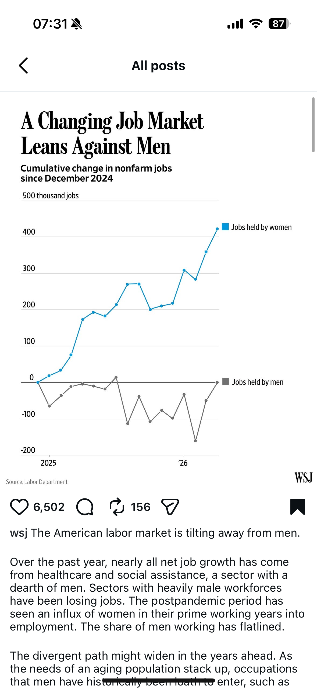
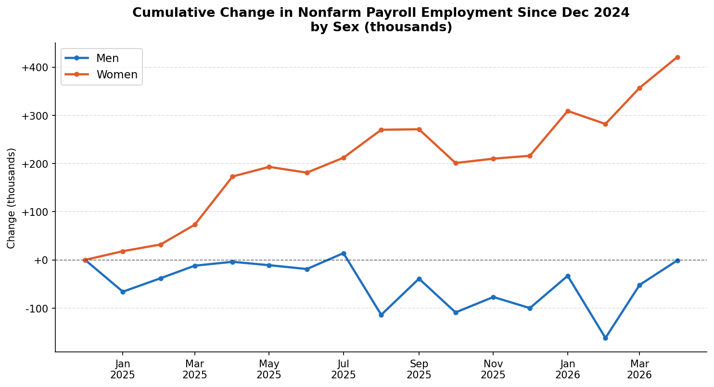
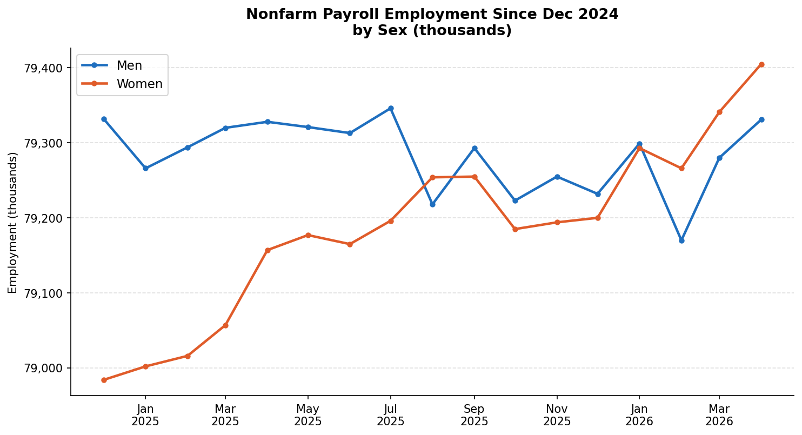

A recent WSJ post showed women gaining far more jobs than men since December 2024.

The data comes from the U.S. Bureau of Labor Statistics, and I was able to reproduce the same chart using their public nonfarm payroll numbers.

So the chart is accurate.

But I started wondering: what does this look like if we don't start from zero change?

When you plot the raw number of jobs held by each group, another picture emerges.

Women started 2025 with roughly 400,000 fewer jobs than men.

By early 2026, the two lines had nearly converged.

So yes, women gained more jobs in this period — and that's real.

And the gap they're closing was large to begin with.

One shows momentum. The other shows scale.

Does seeing both change how you read the story?
